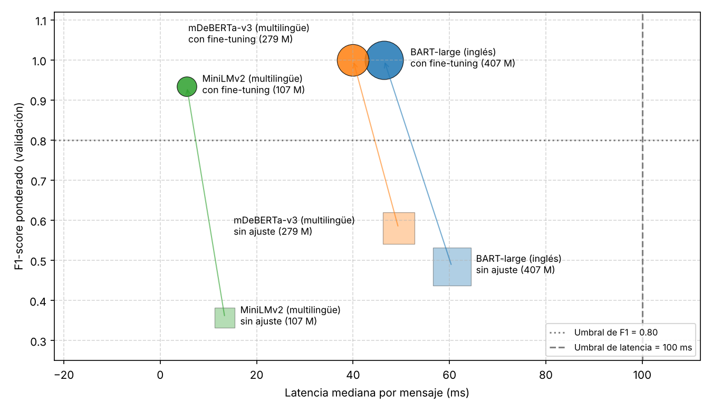
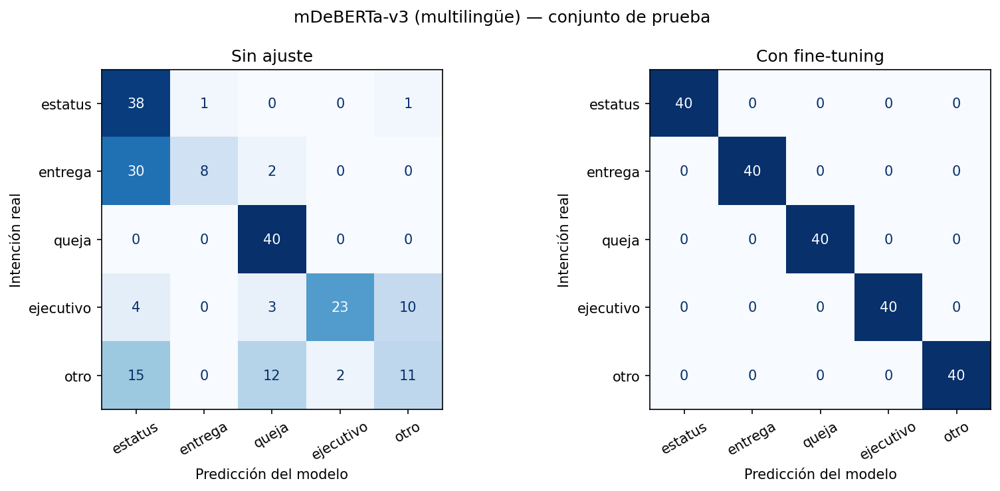

# Actividad 4. Selección de modelos preentrenados de Hugging Face

[](https://colab.research.google.com/github/gagarang25/Actividad4/blob/main/notebooks/Actividad4_Seleccion_Modelos_HF.ipynb)

**Materia:** Gestión de proyectos de inteligencia artificial (Máster en Inteligencia Artificial, Universidad Tecmilenio)
**Estudiante:** T07175241 - Gabriel Alejandro García Ángeles

## Descripción del proyecto

Este prototipo forma parte del proyecto final del curso: un chatbot para que los clientes de Componentes Automotrices del Bajío (CAB, empresa ficticia) consulten el estatus de su orden de compra y la fecha estimada de entrega.

Antes de responder, el chatbot tiene que **entender qué pide el cliente**. Aquí se comparan tres modelos preentrenados de Hugging Face para esa tarea, que consiste en clasificar cada mensaje en una de cinco intenciones:

| Intención | Qué pide el cliente | Qué haría el chatbot |
|---|---|---|
| `estatus_orden` | Saber cómo va su orden | Consultar el estatus en SAP y con el transportista |
| `fecha_entrega` | Saber cuándo llega su pedido | Consultar el modelo de ETA |
| `queja` | Presentar una queja | Pasar la conversación a un ejecutivo |
| `contactar_ejecutivo` | Hablar con una persona | Pasar la conversación a un ejecutivo |
| `otro` | Otro tema (facturas, pagos, cancelaciones) | Avisar que está fuera de su alcance y canalizar |

Los modelos se evalúan primero tal como están publicados (clasificación *zero-shot*) y después con *fine-tuning*, para elegir el más adecuado según su precisión, su latencia y los recursos que necesita.

| Modelo | Identificador en Hugging Face | Por qué se incluyó |
|---|---|---|
| BART-large | `facebook/bart-large-mnli` | El más grande y el más usado para zero-shot; solo inglés |
| mDeBERTa-v3 | `MoritzLaurer/mDeBERTa-v3-base-mnli-xnli` | Tamaño medio y multilingüe |
| MiniLMv2 | `MoritzLaurer/multilingual-MiniLMv2-L6-mnli-xnli` | Pequeño, multilingüe y pensado para ser rápido |

## Estructura del repositorio

```
Actividad4/
├── README.md                  Este documento
├── requirements.txt           Librerías y versiones utilizadas
├── data/
│   └── mensajes_clientes_muestra.csv        Muestra de 2,000 mensajes (400 por intención)
├── notebooks/
│   └── Actividad4_Seleccion_Modelos_HF.ipynb   Cuaderno de Colab ya ejecutado
├── results/
│   ├── metricas_modelos.csv                 Métricas, latencia y recursos (sin ajuste y con fine-tuning)
│   ├── metricas_por_clase.csv               Precision, recall y F1 de cada intención
│   ├── comparacion_test.csv                 Modelo seleccionado en el conjunto de prueba
│   ├── historial_entrenamiento.csv          Validación por época durante el fine-tuning
│   ├── predicciones_validacion.csv          Predicciones de los tres modelos en validación
│   ├── predicciones_test.csv                Predicciones del modelo seleccionado en prueba
│   ├── errores_de_ruta_validacion.csv       Mensajes que el chatbot enviaría a la ruta equivocada
│   ├── errores_de_ruta.csv                  Lo mismo para el modelo seleccionado, en prueba
│   ├── accuracy_por_confianza.csv           Accuracy según la confianza de la predicción
│   ├── entorno_ejecucion.json               GPU, versiones y parámetros del entrenamiento
│   └── *.png                                Matrices de confusión y gráfica de precisión frente a latencia
└── src/
    ├── preparar_dataset.py                  Descarga el dataset del Hub y genera la muestra
    ├── funciones_evaluacion.py              Funciones de evaluación que usa el cuaderno
    ├── analisis_complementario.py           Errores de ruta y accuracy por confianza
    └── grafica_documento.py                 Gráfica de precisión frente a latencia para el reporte
```

## Dataset

- **Origen:** [Bitext customer support LLM chatbot training dataset](https://huggingface.co/datasets/bitext/Bitext-customer-support-llm-chatbot-training-dataset), publicado en Hugging Face Hub. Contiene 26,872 mensajes de clientes a un área de servicio, en inglés, etiquetados con 27 intenciones.
- **Licencia del dataset:** CDLA-Sharing-1.0. La muestra incluida en este repositorio conserva esa licencia.
- **Por qué este dataset:** CAB es una empresa ficticia y no tiene conversaciones reales. Este dataset incluye las intenciones que necesita el chatbot (rastrear una orden, preguntar el plazo de entrega, quejarse, pedir un agente).
- **Cómo se generó la muestra:** con `src/preparar_dataset.py`. El script carga el dataset con la librería `datasets`, agrupa las 27 intenciones originales en las 5 del chatbot, elimina mensajes repetidos y elige 400 mensajes por clase con la semilla 42. Huella MD5 del archivo generado: `b3fedfd804cd1e031640b294855c6f66`.

| Campo | Tipo | Descripción |
|---|---|---|
| `id` | entero | Número consecutivo del mensaje en la muestra (1 a 2000) |
| `mensaje` | texto | Texto del mensaje del cliente, en inglés |
| `intencion` | texto | Etiqueta real: una de las 5 intenciones del chatbot |
| `intencion_original` | texto | Intención que tenía el mensaje en el dataset de Bitext |
| `categoria_original` | texto | Categoría que tenía el mensaje en el dataset de Bitext |
| `num_palabras` | entero | Número de palabras del mensaje |

Agrupación de intenciones: `track_order` → `estatus_orden`; `delivery_period` → `fecha_entrega`; `complaint` → `queja`; `contact_human_agent` y `contact_customer_service` → `contactar_ejecutivo`; las 22 restantes → `otro`.

## Entorno de ejecución

| Elemento | Valor |
|---|---|
| Plataforma | Google Colab |
| GPU | Tesla T4 |
| Python | 3.13 |
| PyTorch | 2.11.0 (CUDA 13.0) |
| transformers | 5.18.0 |
| datasets | 4.8.5 |
| accelerate | 1.15.0 |
| huggingface_hub | 1.33.0 |
| scikit-learn | 1.6.1 |
| Fecha de ejecución | 10 de octubre de 2026 (hora del centro de México) |

El detalle completo está en `results/entorno_ejecucion.json` y en `requirements.txt`.

## Pasos de ejecución

### Opción A: Google Colab (recomendada)

1. Abrir el cuaderno con el botón **Abrir en Colab** de este README.
2. En el menú *Entorno de ejecución → Cambiar tipo de entorno de ejecución*, elegir **GPU T4**.
3. Crear un token de lectura en https://huggingface.co/settings/tokens y guardarlo en *Secrets* de Colab (ícono de llave) con el nombre `HF_TOKEN`, activando el acceso para el cuaderno. El token nunca se escribe en el código.
4. Elegir *Entorno de ejecución → Ejecutar todas*. La ejecución completa tarda alrededor de 15 minutos; la mayor parte es el fine-tuning de los tres modelos.

El cuaderno descarga el dataset, genera la muestra, evalúa los tres modelos sin ajuste, los ajusta, selecciona uno y lo mide en el conjunto de prueba. Los resultados quedan en la carpeta `results/`.

### Opción B: equipo local

```bash
git clone https://github.com/gagarang25/Actividad4.git
cd Actividad4
pip install -r requirements.txt
python src/preparar_dataset.py          # opcional: la muestra ya está en data/
python src/analisis_complementario.py   # errores de ruta y accuracy por confianza (no requiere GPU)
python src/grafica_documento.py         # gráfica de precisión frente a latencia (no requiere GPU)
```

El fine-tuning se ejecuta desde el cuaderno. Se puede abrir con Jupyter en un equipo con GPU; sin GPU funciona, pero tarda mucho más.

## Resultados

Conjunto de validación (200 mensajes), GPU Tesla T4:

| Modelo | Etapa | Accuracy | Precision | Recall | F1 | Latencia mediana | Memoria de GPU |
|---|---|---|---|---|---|---|---|
| BART-large | Sin ajuste | 0.585 | 0.811 | 0.585 | 0.484 | 60.5 ms | 1,597 MB |
| mDeBERTa-v3 | Sin ajuste | 0.610 | 0.712 | 0.610 | 0.580 | 49.4 ms | 607 MB |
| MiniLMv2 | Sin ajuste | 0.465 | 0.589 | 0.465 | 0.356 | 13.4 ms | 433 MB |
| BART-large | Con fine-tuning | 1.000 | 1.000 | 1.000 | 1.000 | 46.4 ms | 1,589 MB |
| mDeBERTa-v3 | Con fine-tuning | 1.000 | 1.000 | 1.000 | 1.000 | 40.0 ms | 1,175 MB |
| MiniLMv2 | Con fine-tuning | 0.935 | 0.944 | 0.935 | 0.934 | 5.5 ms | 433 MB |

Modelo seleccionado (mDeBERTa-v3) en el conjunto de prueba (200 mensajes):

| Etapa | Accuracy | Precision | Recall | F1 | Latencia mediana |
|---|---|---|---|---|---|
| Sin ajuste | 0.600 | 0.689 | 0.600 | 0.562 | 27.5 ms |
| Con fine-tuning | 1.000 | 1.000 | 1.000 | 1.000 | 28.7 ms |





## Conclusiones

1. **Sin ajuste, ningún modelo sirve para el chatbot.** El mejor resultado en validación fue 0.610 de accuracy, frente al 0.80 requerido. Los modelos confunden la pregunta por la fecha de entrega con la de estatus y no reconocen los temas fuera de alcance.
2. **El fine-tuning resolvió el problema.** Con 1,600 mensajes de ejemplo y menos de cinco minutos de entrenamiento por modelo, los tres superan el umbral.
3. **Modelo recomendado: mDeBERTa-v3 con fine-tuning.** Empata en precisión con BART-large usando 32 % menos parámetros y menos memoria, y es multilingüe, lo que permitirá atender también los mensajes en español.
4. **El modelo más rápido no fue la mejor opción.** MiniLMv2 responde en 5.5 ms, pero la latencia no es la limitante del caso y sus errores enviarían a respuesta automática 8 de 200 mensajes que requieren a un ejecutivo.
5. **En el conjunto de prueba**, el modelo seleccionado pasó de 0.600 a 1.000 de accuracy, y los mensajes enviados a la ruta equivocada bajaron de 22 a 0.

**Limitaciones:** el dataset fue construido a partir de plantillas, por lo que los mensajes de entrenamiento y de prueba se parecen entre sí y el 1.000 obtenido seguramente es más alto que lo que se verá con mensajes reales. Los mensajes están en inglés; el desempeño en español no se midió. La latencia se midió en una GPU compartida y varía entre corridas. El modelo ajustado no se publicó en el Hub: se obtiene de nuevo al ejecutar el cuaderno.

## Referencias

Bitext. (s.f.). *Bitext customer support LLM chatbot training dataset* [Conjunto de datos]. Hugging Face. https://huggingface.co/datasets/bitext/Bitext-customer-support-llm-chatbot-training-dataset

Laurer, M. (s.f.-a). *mDeBERTa-v3-base-mnli-xnli* [Modelo de aprendizaje automático]. Hugging Face. https://huggingface.co/MoritzLaurer/mDeBERTa-v3-base-mnli-xnli

Laurer, M. (s.f.-b). *multilingual-MiniLMv2-L6-mnli-xnli* [Modelo de aprendizaje automático]. Hugging Face. https://huggingface.co/MoritzLaurer/multilingual-MiniLMv2-L6-mnli-xnli

Lewis, M., Liu, Y., Goyal, N., Ghazvininejad, M., Mohamed, A., Levy, O., Stoyanov, V., y Zettlemoyer, L. (2020). BART: Denoising sequence-to-sequence pre-training for natural language generation, translation, and comprehension. En *Proceedings of the 58th Annual Meeting of the Association for Computational Linguistics* (pp. 7871–7880). Association for Computational Linguistics. https://aclanthology.org/2020.acl-main.703/

Yin, W., Hay, J., y Roth, D. (2019). Benchmarking zero-shot text classification: Datasets, evaluation and entailment approach. En *Proceedings of the 2019 Conference on Empirical Methods in Natural Language Processing and the 9th International Joint Conference on Natural Language Processing* (pp. 3914–3923). Association for Computational Linguistics. https://aclanthology.org/D19-1404/
